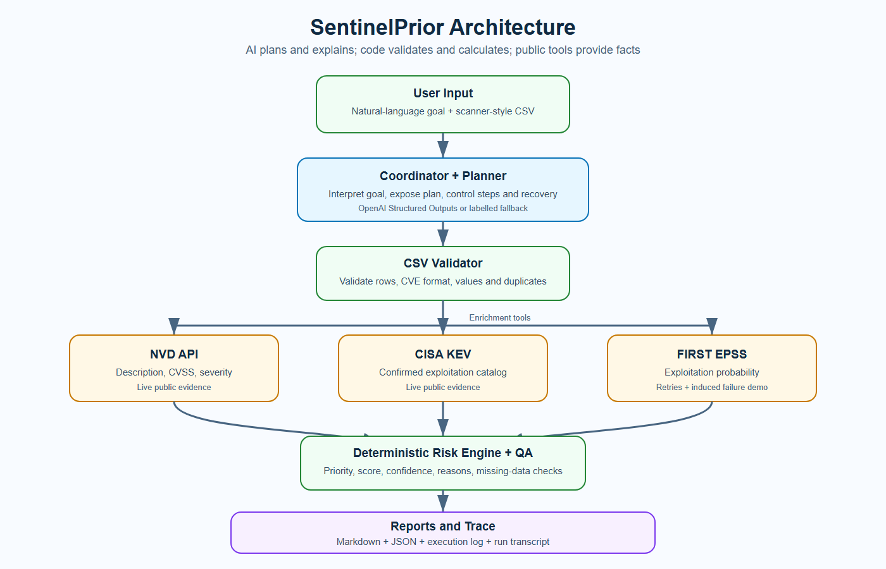

# SentinelPrior

[](https://www.python.org/)
[](https://github.com/arkman0011/SentinelPrior/actions/workflows/tests.yml)
[](#defensive-scope-and-data-safety)

SentinelPrior is a beginner-friendly **agentic vulnerability triage and remediation assistant**. It reads an authorized scanner-style CSV, enriches every CVE with current public evidence, ranks the findings using transparent rules, and produces technical and executive-ready reports.

> **Defensive scope:** SentinelPrior does not scan, exploit, patch, or modify systems. It prioritizes findings that an authorized vulnerability scanner has already identified.



## Contents

- [What it demonstrates](#what-it-demonstrates)
- [How it works](#how-it-works)
- [Quick start](#quick-start)
- [Run the demonstrations](#run-the-demonstrations)
- [Where AI is used](#where-ai-is-used)
- [Input and output](#input-and-output)
- [Reliability and failure handling](#reliability-and-failure-handling)
- [Project structure](#project-structure)
- [Testing](#testing)
- [Limitations](#limitations)
- [Documentation](#documentation)

## What it demonstrates

- A natural-language goal converted into a visible operational plan
- Multiple tools coordinated in one workflow: CSV reader, NVD, CISA KEV, FIRST EPSS, and report writer
- Live vulnerability enrichment without a provided or curated assessment dataset
- Deterministic and explainable vulnerability prioritization
- Input validation, duplicate removal, HTTP retries, and graceful degradation
- A deliberately induced EPSS timeout with recovery and reduced confidence
- Markdown, JSON, execution-log, and transcript outputs
- Optional OpenAI planning and evidence-grounded narrative generation
- Unit tests and GitHub Actions continuous integration

## How it works

1. The user supplies a natural-language goal and scanner CSV.
2. The Planner creates a typed, visible execution plan.
3. The CSV Reader validates the schema, isolates invalid rows, and removes duplicates.
4. NVD supplies standardized descriptions and CVSS information.
5. CISA KEV identifies vulnerabilities known to be exploited in the wild.
6. FIRST EPSS supplies current exploitation-probability scores.
7. The Risk Engine combines threat evidence with internet exposure, business criticality, and environment.
8. Quality checks expose missing or conflicting evidence.
9. The Report Writer creates human-readable and machine-readable results.

The language model does **not** generate CVSS scores, KEV membership, EPSS values, or priority scores. Those values come from public sources and deterministic code.

## Quick start

### Requirements

- Python 3.10 or newer
- Internet access for NVD, CISA KEV, and FIRST EPSS
- An OpenAI API key only if you want AI-created plans and narratives

### Windows PowerShell

```powershell
git clone https://github.com/arkman0011/SentinelPrior.git
cd SentinelPrior
python -m venv .venv
.\.venv\Scripts\python.exe -m pip install --upgrade pip
.\.venv\Scripts\python.exe -m pip install -r requirements.txt
.\.venv\Scripts\python.exe run.py
```

### macOS or Linux

```bash
git clone https://github.com/arkman0011/SentinelPrior.git
cd SentinelPrior
python3 -m venv .venv
source .venv/bin/activate
python -m pip install --upgrade pip
python -m pip install -r requirements.txt
python run.py
```

The default command analyses `data/sample_scan.csv` and writes results to `outputs/`.

## Optional API configuration

The complete live security-data workflow works without an OpenAI key. In that case, the application clearly reports `deterministic fallback` mode.

To enable OpenAI planning and executive-summary generation:

1. Copy `.env.example` to `.env`.
2. Add your key locally:

```dotenv
OPENAI_API_KEY=your_key_here
OPENAI_MODEL=gpt-4o-mini
```

An NVD API key is optional and can be added as `NVD_API_KEY`. It increases the NVD rate limit but does not change the workflow.

`.env` is ignored by Git. Never commit API keys or include them in screenshots, reports, or sample logs.

## Run the demonstrations

### 1. Normal live run

```powershell
.\.venv\Scripts\python.exe run.py `
  --goal "Return the five most urgent findings." `
  --output-dir outputs\normal_run
```

### 2. Deliberately induced EPSS failure

```powershell
.\.venv\Scripts\python.exe run.py `
  --simulate-epss-failure `
  --output-dir outputs\epss_failure_demo
```

The EPSS client retries three times, records the failure, marks EPSS unavailable, lowers evidence confidence, and continues with NVD, CISA KEV, and asset context. It never invents a missing score.

### 3. Invalid and duplicate input

```powershell
.\.venv\Scripts\python.exe run.py `
  --scan data\invalid_and_duplicate_scan.csv `
  --goal "Show the top 2 urgent findings" `
  --output-dir outputs\invalid_input_demo
```

Invalid rows are recorded in the output while valid findings continue through the workflow.

### 4. Explicit deterministic fallback

```powershell
.\.venv\Scripts\python.exe run.py --no-ai --output-dir outputs\fallback_demo
```

Use a separate `--output-dir` for each demonstration. Reusing the same directory overwrites that directory's previous report files.

## Where AI is used

When `OPENAI_API_KEY` is available, the project uses the OpenAI Responses API with Pydantic Structured Outputs to:

1. Interpret the user's natural-language goal.
2. Produce a typed execution plan.
3. Write evidence-grounded remediation narratives and an executive summary.

When the key is absent or the AI call fails, a documented deterministic fallback keeps the workflow runnable. Security facts and final priority scores remain deterministic in both modes.

## Input and output

### Scanner CSV schema

| Column | Meaning | Example |
|---|---|---|
| `asset_id` | Organization-specific asset identifier | `AST-001` |
| `asset_name` | Human-readable asset name | `payment-api-server` |
| `cve_id` | Public CVE identifier | `CVE-2021-44228` |
| `internet_exposed` | Whether the asset is publicly reachable | `true` |
| `business_criticality` | `low`, `medium`, `high`, or `critical` | `critical` |
| `environment` | Deployment environment | `production` |

The included CSV files are synthetic and safe for demonstration. See [Defensive scope and data safety](#defensive-scope-and-data-safety).

### Generated files

Every run creates:

| File | Purpose |
|---|---|
| `vulnerability_report.md` | Human-readable technical and executive report |
| `vulnerability_report.json` | Structured result for integrations or further analysis |
| `execution_log.json` | Machine-readable trace of planning, tool calls, failures, and recovery |
| `run_transcript.md` | Reviewer-friendly step-by-step execution transcript |

Generated runtime reports under `outputs/` are ignored by Git. Curated demonstration transcripts are stored in `docs/sample_runs/`.

## Transparent priority rules

`sentinelprior/risk_engine.py` applies documented rules rather than asking an LLM to guess risk:

- CISA KEV confirmed: +40
- EPSS high/elevated/notable: +25/+18/+10
- Internet-facing asset: +15
- Business criticality: up to +15
- Production environment: +5
- NVD CVSS: up to +10

The score is capped at 100 and mapped to `P0`, `P1`, `P2`, or `P3`. These rules are an explainable demonstration policy, not an industry standard.

## Reliability and failure handling

- All external requests use explicit timeouts and bounded retries.
- Missing evidence stays unavailable instead of being fabricated.
- Tool failures are recorded in the execution trace.
- Confidence is reduced when important evidence is unavailable.
- Invalid CSV rows are isolated so valid rows can continue.
- Quality checks run before reports are written.

### Live data sources

- [NVD CVE API](https://services.nvd.nist.gov/rest/json/cves/2.0)
- [CISA Known Exploited Vulnerabilities catalog](https://www.cisa.gov/known-exploited-vulnerabilities-catalog)
- [FIRST EPSS API](https://api.first.org/data/v1/epss)

## Project structure

```text
SentinelPrior/
├── .github/workflows/tests.yml     # Automated test workflow
├── data/
│   ├── sample_scan.csv             # Normal synthetic demonstration
│   └── invalid_and_duplicate_scan.csv
├── docs/
│   ├── architecture.png            # Architecture diagram
│   ├── architecture.svg            # Editable diagram source
│   ├── ARCHITECTURE.md              # Component responsibilities
│   ├── DESIGN_WRITEUP.md            # Design decisions and limitations
│   ├── ASSESSMENT_CHECKLIST.md      # Rubric-to-evidence mapping
│   └── sample_runs/                 # Three curated run transcripts
├── sentinelprior/
│   ├── tools/                       # CSV, NVD, CISA KEV, and EPSS tools
│   ├── ai_helper.py                 # Optional AI planning and narrative
│   ├── orchestrator.py              # End-to-end coordination
│   ├── risk_engine.py               # Deterministic scoring
│   ├── quality_checks.py            # Evidence validation
│   └── report_writer.py             # Markdown and JSON output
├── tests/                            # Unit tests
├── .env.example                     # Safe configuration template
├── requirements.txt
└── run.py                            # Beginner-friendly entry point
```

## Testing

Run the complete unit-test suite:

```powershell
.\.venv\Scripts\python.exe -m pytest
```

The tests do not call live APIs and do not require API keys. GitHub Actions runs the same suite automatically on pushes and pull requests.

## Defensive scope and data safety

The sample CSV files were created specifically for demonstration. Asset identifiers, names, exposure, business criticality, and environments are fictional. CVE identifiers are real public identifiers so that live enrichment can be demonstrated.

The fictional asset/CVE combinations do **not** represent Xiarch, its customers, or any real production system. A production integration could accept a normalized export from an authorized scanner such as Nessus, OpenVAS, Qualys, or Rapid7 InsightVM. Sensitive real scanner exports must never be placed in a public repository.

## Limitations

- The workflow trusts the scanner's CVE mapping and does not prove that a particular asset is exploitable.
- Absence from CISA KEV is not proof that exploitation has never occurred.
- EPSS is a probability estimate, not a guarantee.
- Asset exposure and criticality are supplied by the input and must be maintained by the organization.
- Live-source changes can produce different results across runs.
- The demonstration scoring policy needs organization-specific validation before production use.
- A qualified human must review and approve remediation actions.

## Troubleshooting

### `Scanner file not found`

Use the included path exactly:

```powershell
.\.venv\Scripts\python.exe run.py --scan data\sample_scan.csv
```

### `AI mode: deterministic fallback`

This is expected when `OPENAI_API_KEY` is missing or an AI request cannot complete. The public security-data workflow still runs. Add a valid key to your local `.env` only if AI-created planning is required.

### Public API timeout or rate limit

Retry later, check internet access, and optionally configure an NVD API key. The execution log records unavailable evidence and recovery behavior.

## Documentation

- [Architecture and component responsibilities](docs/ARCHITECTURE.md)
- [Design decisions, limitations, and future work](docs/DESIGN_WRITEUP.md)
- [Assessment rubric mapping](docs/ASSESSMENT_CHECKLIST.md)
- [Normal live run](docs/sample_runs/01_normal_live_run.md)
- [EPSS failure and recovery](docs/sample_runs/02_epss_failure_recovery.md)
- [Invalid-input recovery](docs/sample_runs/03_invalid_input_recovery.md)

## Responsible use

Use SentinelPrior only with vulnerability data you are authorized to process. Treat its output as decision support, not an instruction to change a production system automatically.
